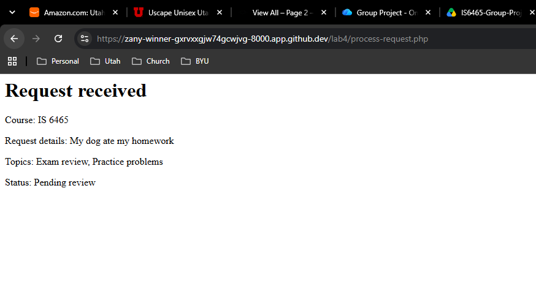

Part 1:

When you submit a request, assuming your request passes all the validation benchmarks, then you will receive a confirmation page. Just like the image that I have provided.

Part 2:
1. header.php contains all the header information for each page. This is information such as the title of "Peer tutoring Hub" at the top of each page.
2. nav.php contains the links to each page at the top of the nav bar. Essentially it's a page that is used again and again for each page.
3. footer.php is the same deal as the other two except it pertains to the bottom of the page. That footer code is provided on each page.
4. It's appropriate because it allows a developer to reuse the same code for each page. While every page should be different, navbars, headers, and footers, should stay uniform across every page.

Part 3:
1. reason: This allows students to submit a description of the things they need help with. It's a string that php recieves.
2. topics[]: This let's students select one or more topics they don't understand. php recieves and array of strings in this one.
3. preferredtime: This is a choice option for students between morning, afternoon, and night. A string is recieved by Php.
4. preferreddate: This is when the student would like to have their tutoring appointment. This is also a string, but it is in a date format such as YYYY-MM-DD
5. form-name: This is a hidden field that identifies this form as a tutoring request. It is also a string.

Part 4:
Test 1 - Valid request
1. Exam Review, Morning, IS 6465, 10/27/2026, "My dog ate my homework"
2. Was accepted
3. Message Displayed: Request received
4. All were checked: topics, preferredtime, preferreddate, etc
Test 2 - Missing or invalid value
1. Exam Review, IS 6465, "My dog at my hw", the rest were blank
2. Was not accepted
3. Displayed message to "Please fill out this field" under the date
4. All were checked, but preferreddate and topics failed
Test 3 - Past date
1. Exam Review, Morning, IS 6465, 10/20/2026, "My dog ate my homework"
2. Was not accepted
3. Message Displayed: Request could not be submitted
4. All were checked, but valid date didn't pass on the process-request.php file. This is why the form wasn't fully processed.

Part 5:
Preferred time: Valid time, Missing Time, Altered value; Topics: Multiple valid topics, Missing topics, Altered topic, Reason length: Minimum length, Maximum length, Too short, Too long
create: request-form.php & process-request.php
read one: request-details.php
read all: requests.php
update: edit-request.php
delete: delete-request.php

1. request_id, so like request-details.php?request_id=12
2. Viewing retrieves information without changing it. So if you don't want to change it.
3. Updates and deletions change data. Post is the appropriate method for submitting changes; the application should also protect those acctions with authorization and CSRF checks.