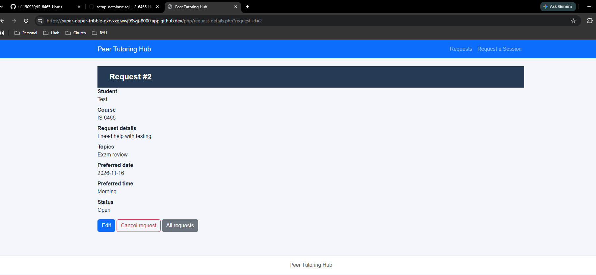

Part 2: Run the Application:
1. https://super-duper-tribble-gxrvxxgjwwj93wjj-8000.app.github.dev/php/request-form.php
2. The request information was all there when I entered it in
3. 

Part3: 
What I did:
I made a request called Test, with all the other required field filled out. I expected it all to work. Just as expected, I was able to submit the request, it was able to be viewed and edited. I also was able to cancel it, and can no longer edit it after cancelation.

Part 4:
1. edit-request.php
2. request-details.php
3. config/db.php
4. services/requestService.php
5. studentPDO.php, requestPDO.php, and setup-database.sql
6. students
7. tutoring_requests
8. .student_id is a foreign key on the requests table, and a primary key on the student table

SQL statements belong in the repository files because those files handle communication with SQLite, while the form page should focus on collecting and displaying user input. This separation keeps database details out of the user interface and makes queries easier to reuse, maintain, and test. The service coordinates validation and business logic, then calls the repositories to read or write data.

Part 5:
PASS UC01 create and Open
PASS Lab 4 checkbox values preserved
PASS Duplicate email reuses student
PASS UC02 course and status filter
PASS Invalid reason rejected
PASS Invalid submission writes nothing
PASS Edit Open request
PASS Updated reason persisted
PASS Cancel Open request
PASS Cancelled row retained
PASS Second cancellation rejected
PASS Unrelated request unchanged
PASS FK enforced
PASS UC02 empty filter result
All integration checks passed

Part 6:
Explain how a tutoring request moves from php/request-form.php through PHP, PDO, and SQLite in this project. Identify the responsibility of each file.
AI:
The form in `php/request-form.php` collects the student's details and tutoring preferences, then sends them with POST to `php/process-request.php`. The process file checks the request, opens the database connection through `config/db.php` (which creates the PDO connection to SQLite), and calls `services/requestService.php`. The service validates the submission and manages a transaction, using `repositories/studentPDO.php` to find or add the student and `repositories/requestPDO.php` to insert the tutoring request. PDO executes those repository SQL statements against `database/tutoring.db`; `database/setup-database.sql` defines and seeds the tables.

Seems to be right to me

Trace the requirement “a student can submit a tutoring request” through the PHP files, service, repositories, SQLite tables, and integration tests in this project
AI:
A student’s request follows this path:

1. php/request-form.php collects the student’s name and email, course, preferred date and time, and tutoring details. It submits the form via POST to process-request.php.
2. php/process-request.php checks that the request is a valid form submission, opens the database through config/db.php, and calls the service.
3. services/requestService.php validates the submitted values, starts a transaction, and coordinates saving the student and request.
4. repositories/studentPDO.php inserts the student if their email isn’t already in the database, then looks them up. repositories/requestPDO.php inserts the tutoring request using that student’s ID.
5. SQLite stores student details in students and request details in tutoring_requests. The student_id column in tutoring_requests is a foreign key to students.student_id, linking the request to its submitter. The schema and relationship are defined in database/setup-database.sql.

tests/integration-tests.php tests the service against an in-memory SQLite database. It checks that a submitted request is saved as Open, repeat submissions reuse the student record, invalid submissions write nothing, and the foreign-key relationship is enforced.

Table:
Requirement: Student submits a tutoring request 
Application Page:  `php/request-form.php` posts to `php/process-request.php`
Service or Validation: `services/requestService.php` validates the submission and coordinates the transaction; `includes/validation.php` validates time, topics, and reason
Repository or SQL: `repositories/studentPDO.php` finds or inserts the student; `repositories/requestPDO.php` inserts the request; `database/setup-database.sql` defines the schema
Database Table: `students` and `tutoring_requests` (linked by `student_id`) 
Test Evidence:`tests/integration-tests.php`: “UC01 create and Open,” “Duplicate email reuses student,” “Invalid submission writes nothing,” and “FK enforced” 

AI Test Suggestion: A cancelled tutoring request cannot be edited

1. tests/integration-tests.php checks that an open request can be edited and that cancellation succeeds, but it does not try to edit a request after cancellation.
2. How to test it: In the integration test, after cancelling $id, call reviseRequest($pdo, $id, $edit) and assert it returns false. Also verify the request remains Cancelled and its saved details haven’t changed. This matches the status='Open' condition in repositories/requestPDO.php and the response handling in php/update-request.php. Manually, cancel a request, open its edit page, and confirm the edit form is unavailable.
3. Yes. It checks the application’s existing rule that only open requests can be edited, and it can be tested using the project’s existing integration-test setup. Run the test to confirm the behavior.

Part 7:
The join is just joining the requests table to the students table. It will show all requests, and the student they are attached to with their information.
