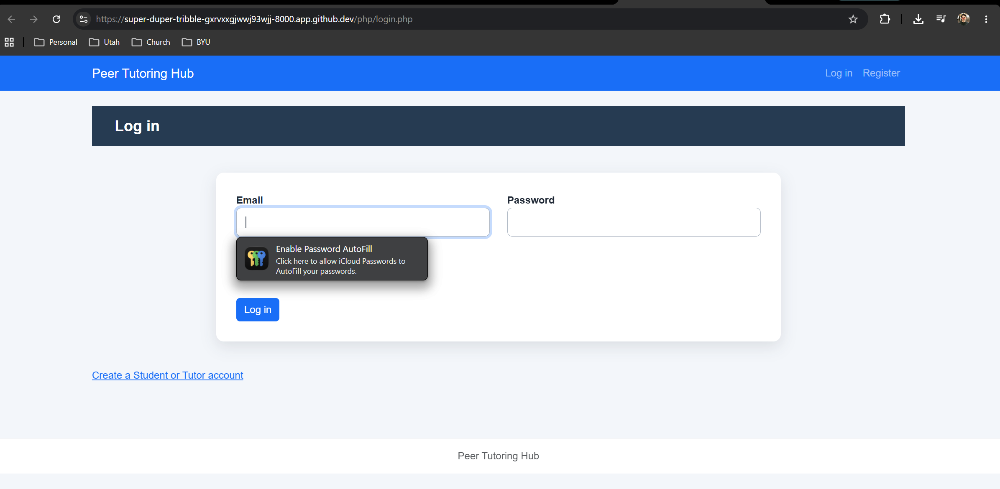
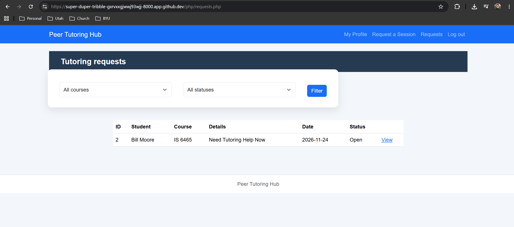
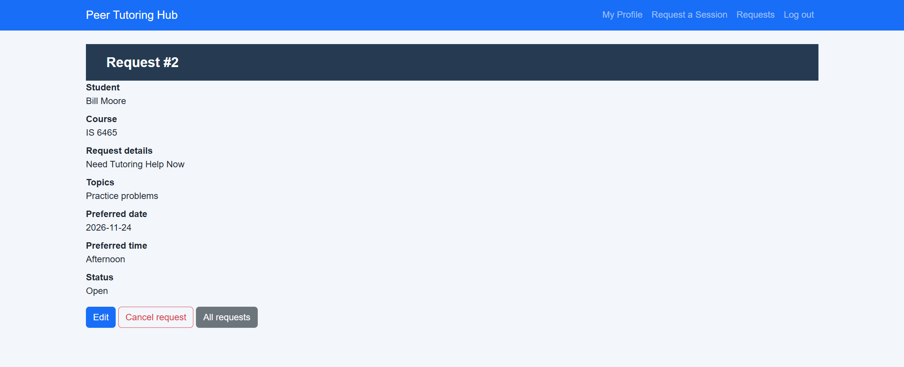
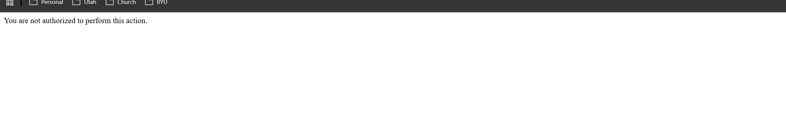
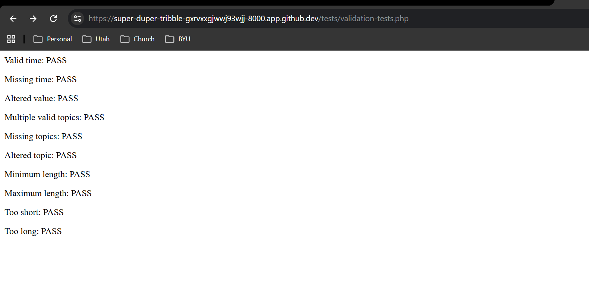
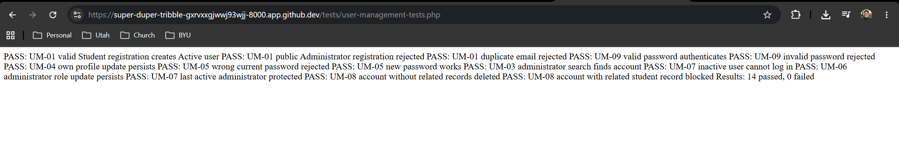
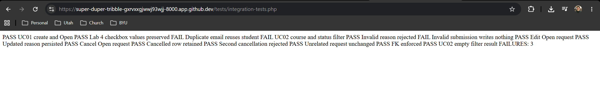
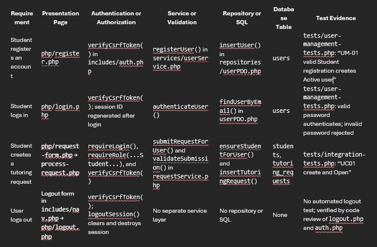

Part 2:
1. @u1190930 ➜ /workspaces/IS-6465-Harris/lab7/database (main ✗) $ sqlite3 tutoring.db < setup-database.sql
@u1190930 ➜ /workspaces/IS-6465-Harris/lab7/database (main ✗) $ sqlite3 tutoring.db < upgrade-to-user-management.sql

2. sqlite> .tables
students           tutoring_requests  users

3. sqlite> .tables
students           tutoring_requests  users     

Part 3:
1. @u1190930 ➜ /workspaces/IS-6465-Harris/lab7/database (main ✗) $ php create-admin.php "Nick Harris" bb@cc.com "12345678901112"
Xdebug: [Step Debug] Could not connect to debugging client. Tried: localhost:9000 (through xdebug.client_host/xdebug.client_port) :-(
Administrator account created with user ID 1.

Part 4:

As you can see from the screenshot, the app opened successfully and I was brought to the login page with the URL at the top. I was not in the app, but had to create an account first.

Part 5:

Bill Moore was the student I created, while logged in I created the tutoring request in the screenshot. I edited it just like the video by adding the word "now".

Part 6:
1. The authentication is the password and username/account setup 
2. The authorization is the admin access and prevledges.
3. They can't see as much information. Only their own
4. Seeing all requests and managing users
5. 

Part 7:

Registration
1. php/register.php
2. php/register.php receives its own POST form.
3. includes/auth.php — csrfToken() creates the token; verifyCsrfToken() verifies it.
4. services/userService.php — registerUser() validates the registration fields.
5. services/userService.php — registerUser() calls password_hash() before saving.
6. repositories/userPDO.php — insertUser() inserts the user.
repositories/studentPDO.php — ensureStudentForUser() inserts a student record later, when a Student submits a tutoring request.
7. Registration inserts a record into the SQLite users table only. A students record is created later during the tutoring-request workflow.

User Login workflow
1. php/login.php
2. php/login.php receives its own POST form.
3. repositories/userPDO.php — findUserByEmail().
4. services/userService.php — authenticateUser() uses password_verify().
5. It regenerates the session ID, stores user_id, display_name, role, and last_activity in $_SESSION, creates a CSRF token, then redirects to profile.php.
6. Regenerating the session ID prevents session-fixation attacks by ensuring an ID issued before login cannot remain valid after authentication.
7. The user’s role column is retrieved from the users table and stored in $_SESSION['role']. Protected pages reload the current user and use requireRole() in includes/auth.php to allow Student or Administrator access.

Password hashing and verification belong in the application/service layer because this is where the application receives and validates submitted credentials. Presentation pages should only collect and display information, while database setup scripts should define tables rather than handle login behavior. Keeping credential logic in userService.php makes it reusable, testable, and prevents plain-text passwords from being stored.

Part 8:

Failed Tests: Duplicate email reuses, UC02 course and status filter, and Invalide submission writes nothing.
I believe these tests checks were checking to see if these measures were ever used. Since there wasn't an opportunity to try these tests, they come as fails by default.

Part 9:

Part 10:
1. The left join is only joining the student information to the user information. If they have a different role, you won't see it
2. It connects through their id.
3. Because not ever user is a student. There are different roles in the application.
4. Because once again, admin are not students.